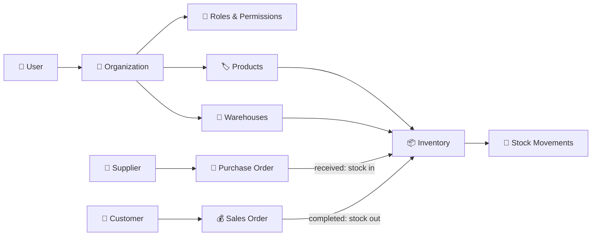

<div align="center">

# 📦 StockPilot

### Multi-Tenant Inventory & Order Management — Backend API

*Run inventory, suppliers, customers, purchase orders and sales orders for many businesses from a single, secure backend.*


</div>

---

## 🌟 What is StockPilot?

**StockPilot** is a SaaS-style backend that lets many different businesses (called **organizations**) manage their stock in one place, with their data kept completely separate from each other.

Each organization can:

- 🧾 Keep a catalog of products (with variants like *Red / XL*)
- 🏬 Track stock across multiple warehouses
- 🚚 Buy from suppliers and sell to customers
- 👥 Invite team members and control what each person can do
- 📊 View reports and get low-stock alerts

---

## ✨ Features

| | Feature | What it does |
|---|---|---|
| 🏢 | **Multi-tenancy** | Every business gets its own private workspace. Users can belong to several organizations and switch between them. |
| 🔐 | **Roles & permissions** | Fine-grained access (e.g. `product:create`, `stock:adjust`) with roles like owner, admin, manager, staff and viewer. |
| ✉️ | **Team invitations** | Invite people by email with a secure token and expiry. |
| 🏷️ | **Categories & products** | SKU, barcode, unit, cost and selling price, reorder level, and product variants. |
| 🏬 | **Warehouses** | Track quantities per warehouse, per product, per variant. |
| 🔄 | **Stock movements** | Full history of every stock in, out, adjustment and transfer, with the quantity left after each change. |
| 🤝 | **Suppliers & customers** | Keep contact details for the people you buy from and sell to. |
| 🛒 | **Purchase orders** | `draft → ordered → received / cancelled`. Receiving an order adds stock. |
| 💰 | **Sales orders** | `draft → confirmed → completed / cancelled`, with tax, discount and cost snapshot for profit tracking. |
| 🔔 | **Notifications** | Low stock, new purchases, new sales and order status updates. |
| 📁 | **CSV import / export** | Move data in and out with spreadsheets. |
| 📈 | **Reports** | Business insights and profit & loss data. |
| 🕵️ | **Audit logs** | Records who did what, with old and new values. |
| 💳 | **Subscriptions** | Free, Pro and Business plans with usage limits. |

---

## 🧰 Tech Stack

| Layer | Technology |
|---|---|
| Framework | **FastAPI** |
| ORM | **SQLAlchemy** |
| Database | **PostgreSQL** (production) · **SQLite** (local default) |
| Config | Environment variables |

> 💡 The app uses **SQLite** automatically if no `DATABASE_URL` is set, so it works out of the box on your computer. For production, set `DATABASE_URL` to a PostgreSQL connection string.

---

## 🗂️ Project Structure

```
StockPilot---backend/
├── main.py          # App entry point: CORS, routers, startup seeding, health check
├── database.py      # Database connection (PostgreSQL or SQLite)
├── models.py        # All database tables
└── router/          # One file per feature
    ├── auth.py
    ├── organizations.py
    ├── users.py
    ├── categories.py
    ├── products.py
    ├── warehouses.py
    ├── inventory.py
    ├── suppliers.py
    ├── customers.py
    ├── purchase_orders.py
    ├── sales_orders.py
    ├── reports.py
    ├── notifications.py
    ├── csv_io.py
    ├── audit_logs.py
    └── subscriptions.py
```

---

## 🧠 How It Works



### 🏢 Multi-tenancy in one minute

Almost every table has an `organization_id`. Every query is filtered by the user's **current organization**, so one business can never see another business's data.

### 🔑 Permissions

Permissions are simple codes such as `product:create` or `stock:adjust`. A **role** is a bundle of permissions, and each **member** of an organization is assigned a role. Default permissions and the **Free / Pro / Business** plans are created automatically when the server starts.

---

## 🗄️ Database Overview

| Area | Tables |
|---|---|
| 👥 **Access** | `users`, `organizations`, `organization_members`, `roles`, `permissions`, `role_permissions`, `invitations` |
| 🏷️ **Catalog** | `categories`, `products`, `product_variants` |
| 📦 **Stock** | `warehouses`, `inventory`, `stock_movements` |
| 🤝 **Partners** | `suppliers`, `customers` |
| 🛒 **Orders** | `purchase_orders`, `purchase_order_items`, `sales_orders`, `sales_order_items` |
| 🔔 **System** | `notifications`, `audit_logs` |
| 💳 **Billing** | `plans`, `subscriptions`, `payments` |

### Order lifecycles

| Purchase Order | Sales Order |
|---|---|
| `draft` → `ordered` → `received` | `draft` → `confirmed` → `completed` |
| or `cancelled` | or `cancelled` |

---

## 💳 Plans

StockPilot ships with three plans: **Free**, **Pro** and **Business**. Each plan can limit:

- 👥 Number of users
- 🏷️ Number of products
- 🏬 Number of warehouses
- 🧾 Orders per month
- 📁 CSV import / export
- 📈 Reports
- 🕵️ Audit logs

---

## 🔌 API

The API is split into feature modules (auth, organizations, users, categories, products, warehouses, inventory, suppliers, customers, purchase orders, sales orders, reports, notifications, CSV, audit logs and subscriptions).

Once the server is running, explore every endpoint interactively:

| Page | Address |
|---|---|
| 📘 Swagger UI | `/docs` |
| 📗 ReDoc | `/redoc` |
| ❤️ Health check | `GET /` → `{"status": "ok", "app": "StockPilot"}` |
